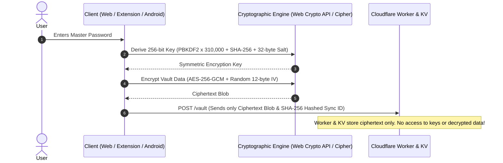

<p align="center">
  
</p>

# 🛡️ ReWord by Reyad | Open Source Zero-Knowledge Password Manager & Autofill Suite
### مدير كلمات المرور الآمن والمشفر بمبدأ المعرفة الصفرية (Zero-Knowledge) من تطوير Mohamed Reyad

[](https://pages.cloudflare.com/)
[](https://workers.cloudflare.com/)
[](./extension)
[](./android)
[](./ReWord.apk)
[-blueviolet)](#-نموذج-الأمان-والتشفير-security--cryptography-model)
[](LICENSE)

**ReWord by Reyad**, created by **Mohamed Reyad (@reyad-dev)**, is an open-source zero-knowledge password manager with encrypted sync, Chrome autofill, a native Android app, and self-hosted Cloudflare deployment.

**Android 1.2.2:** [Release & APK downloads](https://github.com/reyad-dev/reword-app/releases/tag/v1.2.2) · [Installation and signing notes](android/CHANGELOG.md#downloads-and-installation).

---

### 🌐 اختار لغة الدليل / Choose Language:
* [📖 الدليل باللغة العربية (Arabic Documentation)](#-الدليل-باللغة-العربية)
* [📖 English Documentation](#-english-documentation)

---

# 📖 الدليل باللغة العربية

## 🌟 نظرة عامة (Overview)

**ReWord by Reyad** هو نظام متكامل ومفتوح المصدر من تطوير **محمد رياض (@reyad-dev)** لإدارة كلمات المرور وتأمين الهوية الرقمية، مصمم بالكامل وفق مبدأ **المعرفة الصفرية (Zero-Knowledge)** ونهج **الاستضافة الذاتية المجانية (Self-Hosted)**. 

يتيح لك النظام امتلاك خزنتك المشفرة دون الاعتماد على أي خوادم تتبع لأطراف ثالثة:
* **تطبيق ويب تقدمي (PWA):** يعمل محلياً بدون إنترنت (Offline-First) ويُستضاف مجاناً على **Cloudflare Pages**.
* **محفظة وخادم مزامنة مشفر (Sync Backend):** يعمل عبر دوال سحابية فائقة السرعة على **Cloudflare Workers & KV** على حسابك الشخصي مجاناً بتكلفة **0$**.
* **إضافة متصفح كروم (Chrome Extension - Manifest V3):** تكتشف صفحات تسجيل الدخول وتوفر ملء تلقائي آمن بضغطة زر.
* **تطبيق أندرويد أصلي (Native Kotlin & Jetpack Compose):** يوفر خدمة الملء التلقائي الشاملة للنظام (System Autofill Service) مع حصر الظهور بدقة في حقول (اسم المستخدم، البريد الإلكتروني، وكلمات المرور) وتأكيد العمليات ببصمة الإصبع أو الوجه (`BiometricPrompt`).

> [!IMPORTANT]
> **مبدأ المعرفة الصفرية (Zero-Knowledge):**
> لا يتم إرسال كلمة المرور الرئيسية أو أي بيانات غير مشفرة إلى أي خادم إطلاقاً. كافة عمليات التشفير وفك التشفير تتم محلياً 100% داخل جهاز المستخدم باستخدام واجهة التشفير القياسية `Web Crypto API` على الويب والإضافة، و `Cipher (AES-GCM)` على الأندرويد. خوادم Cloudflare لا تخزن سوى كتل بيانات مشفرة بالكامل (Ciphertext Blobs) لا يمكن فكها بدون كلمتك الرئيسية.

---

## ✨ المميزات الرئيسية (Core Features)

* 🔐 **تشفير قياسي فائق الأمان (Military-Grade Cryptography):**
  * تشفير متماثل **AES-256-GCM** مع Salt فريد (32 بايت) و IV عشوائي (12 بايت) لكل عملية حفظ.
  * اشتقاق المفاتيح عبر **PBKDF2 مع SHA-256 بـ 310,000 تكرار** (مطابق لتوصيات OWASP لمقاومة هجمات القوة الغاشمة).
  * حماية هويات المزامنة بتوليد كود SHA-256 لا يمكن عكسه (`reword:v1:${syncId}`).

* 🔄 **استيراد وتصدير شامل لكلمات المرور (Password Import & Export):**
  * **استيراد من المتصفحات عبر ملفات CSV:** يدعم استيراد كلمات المرور المحفوظة من **Google Chrome**، **Microsoft Edge**، **Mozilla Firefox**، و **Apple Safari**.
  * **استيراد من مديري كلمات المرور:** متوافق مع ملفات CSV المصدرة من Bitwarden و 1Password و LastPass (كشف تلقائي للأعمدة: اسم الموقع، الرابط، اسم المستخدم/البريد، كلمة المرور).
  * **استيراد وتصدير الخزائن المشفرة:** تصدير واستيراد ملفات `.reword` المشفرة للنقل الفوري والنسخ الاحتياطي بين الأجهزة.
  * **تصدير تقارير إكسل (XLSX):** تصدير بيانات الحسابات إلى ملف إكسل منسق وجاهز للطباعة مبني كلياً بصيغة OpenXML بدون أي مكتبات خارجية.
  * **تصدير CSV قياسي:** إمكانية تصدير البيانات كملف CSV عام.

* 📱 **تطبيق أندرويد أصلي متكامل (Native Android App):**
  * مبني بالكامل بلغة **Kotlin** مع واجهات **Jetpack Compose (Material 3)** وخط عربي أنيق.
  * دعم **خدمة الملء التلقائي القياسية (Android Autofill Framework)** مع حصر الاقتراحات الذكية في حقول:
    * اسم المستخدم (Username)
    * البريد الإلكتروني (Email Address)
    * كلمات المرور (Password / PIN)
  * **منع الإزعاج في التطبيقات الأخرى:** لا يظهر التطبيق إطلاقاً في حقول الرسائل والمحادثات (مثل رسائل واتساب وتلغرام) أو حقول البحث والتعليقات.
  * حماية بيومترية متقدمة عبر بصمة الإصبع أو الوجه (`BiometricPrompt`) مع حماية مفاتيح التشفير عبر عتاد الهاتف المشفر (`Android Keystore`).

* ⚡ **إضافة جوجل كروم (Manifest V3):**
  * كشف فوري لحقول الدخول مع زر درع ReWord التفاعلي وقائمة منسدلة للحسابات المتطابقة.
  * قفل تلقائي ذكي بعد فترة عدم نشاط، ونظام تنظيف فوري للأيقونات عند إرسال النموذج أو تسجيل الدخول.

* ☁️ **استضافة ذاتية مجانية 100% (Cloudflare Serverless):**
  * استضافة موقع الويب على **Cloudflare Pages** بسرعة البرق وشبكة CDN عالمية.
  * تشغيل محفظة المزامنة عبر **Cloudflare Worker & KV** مجاناً (100,000 طلب يومياً و1 جيجابايت تخزين مجاناً مدى الحياة وبدون بطاقة بنكية).

---

## 📥 استيراد كلمات المرور المدعومة (Supported Import Formats)
يوفر التطبيق محرك استيراد ذكي يقوم بفرز الأعمدة، واستخراج أسماء المواقع من الروابط تلقائياً، وتفادي تكرار الحسابات الموجودة:

| المصدر / التنسيق | نوع الملف | الأعمدة المدعومة تلقائياً |
| :--- | :---: | :--- |
| **نسخة احتياطية ReWord** | `.reword` / `.json` | استيراد كامل للخزينة مع التشفير والملاحظات والحسابات المتعددة |
| **جوجل كروم (Google Chrome)** | `.csv` | `name`, `url`, `username`, `password` |
| **مايكروسوفت إيدج (Microsoft Edge)** | `.csv` | `name`, `url`, `username`, `password` |
| **موزيلا فايرفوكس (Mozilla Firefox)** | `.csv` | `url`, `username`, `password`, `httpRealm`, `formActionOrigin` |
| **أبل سفاري (Apple Safari)** | `.csv` | `Title`, `URL`, `User Name`, `Password` |
| **بت واردن (Bitwarden)** | `.csv` | `folder`, `favorite`, `type`, `name`, `notes`, `login_uri`, `login_username`, `login_password` |
| **أي ملف CSV عام** | `.csv` | أي ملف يحتوي على أعمدة للرابط (`url`/`origin`) واسم المستخدم (`username`/`login`/`user`) وكلمة المرور (`password`) |
### خطوات استيراد كلمات المرور:
1. افتح تطبيق الويب (أو التطبيق المثبت على جهازك).
2. افتح **الإعدادات (Settings)** من أعلى الشاشة.
3. اضغط على **"استيراد من المتصفح (CSV)"** واختر الملف المصدر من متصفحك أو تطبيقك السابق.
4. سيتم فوراً استيراد كافة الحسابات وتصنيفها وتشفيرها داخل خزينتك مع إشعار بنجاح العملية وعدد الحسابات الجديدة.

---

## 🏗️ آلية العمل والمعمارية (Architecture)

```
┌────────────────────────────────────────────────────────┐
│             جهاز المستخدم (Client-Side)                │
│                                                        │
│  [ المتصفح / PWA ]  أو  [ إضافة كروم ]  أو  [ الأندرويد ]  │
│        │                      │                   │    │
│    IndexedDB              Autofill            Keystore │
│        │                      │                   │    │
│        ▼                      ▼                   ▼    │
│    Crypto Engine: PBKDF2 (310k) + AES-256-GCM           │
│    (التشفير وفك التشفير يتم محلياً 100% داخل جهازك!)   │
└───────────────────────────┬────────────────────────────┘
                            │
               يرسل فقط كتل بيانات مشفرة
                    (Encrypted Blob)
                            │
                            ▼
┌────────────────────────────────────────────────────────┐
│             سيرفرات Cloudflare (Serverless)            │
│                                                        │
│   [ Cloudflare Pages ] ──> استضافة الواجهة (Frontend)  │
│   [ Cloudflare Worker ] ──> خادم المزامنة (/vault)     │
│   [ Cloudflare KV ] ────> تخزين كتل البيانات المشفرة  │
│   (السيرفر لا يرى كلمات المرور أو البيانات أبداً!)    │
└────────────────────────────────────────────────────────┘
```

---

## 🚀 دليل التحميل والرفع على Cloudflare خطوة بخطوة

يمكنك تشغيل واستضافة النظام بالكامل (الموقع + المحفظة وخادم المزامنة) على حسابك الشخصي المجاني في Cloudflare بخطوات بسيطة:

### الخطوة 1: تحميل المشروع (Download / Clone)

* **باستخدام Git:**
  ```bash
  git clone https://github.com/<your-username>/reword-app.git
  cd reword-app
  ```
* **أو بدون Git:**
  * اضغط على زر **Code** الأخضر أعلى صفحة المستودع في GitHub ثم اختر **Download ZIP**.
  * فك الضغط عن الملف في مجلد على جهازك.

---

### الخطوة 2: رفع الموقع الإلكتروني على Cloudflare Pages (الموقع)

تطبيق الويب عبارة عن تطبيق PWA ثابت (Static Web App)، ويمكن رفعه وتشغيله عبر طريقتين:

#### الطريقة الأولى: عبر لوحة تحكم Cloudflare (سهلة وبدون سطر أوامر - موصى بها)
1. سجّل الدخول إلى حسابك في [Cloudflare Dashboard](https://dash.cloudflare.com/).
2. من القائمة الجانبية، اختر **Compute (Workers & Pages)** ⬅ ثم اضغط **Create application**.
3. اختر تبويب **Pages** ⬅ ثم اختر:
   * **Connect to Git:** اربط حساب GitHub واختر مستودع `reword-app` الخاص بك.
     * في إعدادات البناء (Build settings):
       * Framework preset: اتركه `None`.
       * Build command: اتركه فارغاً.
       * Build output directory: اكتب `.` (أو اتركه الافتراضي).
     * اضغط **Save and Deploy**.
   * **أو Direct Upload (بدون ربط جيت هب):**
     * اكتب اسم المشروع (مثلاً: `reword-vault`).
     * اسحب وأفلت مجلد المشروع (الذي يحتوي على `index.html` و `core.js` و `style.css` و `sw.js` و `manifest.json`).
     * اضغط **Deploy site**.
4. ستحصل فوراً على رابط موقعك الخاص (مثال: `https://reword-vault.pages.dev`). يمكنك فتح الرابط من أي هاتف أو كمبيوتر وتثبيته كـ PWA.

#### الطريقة الثانية: عبر سطر الأوامر (Wrangler CLI)
```bash
# تسجيل الدخول إلى كلاودفلير
npx wrangler login

# رفع مجلد الموقع مباشرة
npx wrangler pages deploy . --project-name=reword-vault
```

---

### الخطوة 3: رفع محفظة المزامنة المشفرة على Cloudflare Workers & KV (المحفظة)

لتمكين المزامنة الفورية بين موقع الويب، وإضافة المتصفح، وتطبيق الأندرويد، ستقوم بإنشاء دالة Worker خفيفة وقاعدة بيانات KV مشفرة:

#### الطريقة الأولى: عبر لوحة تحكم Cloudflare (سهلة ومباشرة)
1. **إنشاء قاعدة بيانات KV (مخزن المحفظة):**
   * من القائمة الجانبية في Cloudflare، اذهب إلى **Storage & Databases** ⬅ ثم **KV**.
   * اضغط على **Create namespace**، واكتب الاسم: `vaults` ثم اضغط **Add**.
2. **إنشاء دالة الـ Worker:**
   * من القائمة الجانبية، اختر **Compute (Workers & Pages)** ⬅ ثم **Create application** ⬅ تبويب **Workers** ⬅ اضغط **Create Worker**.
   * اكتب اسماً للدالة (مثلاً: `reword-sync`) واضغط **Deploy**.
3. **وضع كود المزامنة المشفرة:**
   * داخل صفحة الوركر، اضغط زر **Edit code**.
   * احذف الكود الافتراضي، وانسخ كود ملف [`worker/index.js`](./worker/index.js) بالكامل من هذا المستودع والصقه بدلاً منه.
   * اضغط **Save and deploy** في الزاوية العلوية.
4. **ربط الـ KV بالوركر (خطوة هامة جداً):**
   * ارجع لصفحة إعدادات الوركر ⬅ اضغط تبويب **Settings** ⬅ ثم **Bindings** (أو **Variables and Secrets**).
   * تحت قسم **KV Namespace Bindings**، اضغط **Add**.
   * في خانة **Variable name** اكتب بدقة بأحرف كبيرة: `VAULTS`.
   * في خانة **KV namespace** اختر قاعدة البيانات التي أنشأتها: `vaults`.
   * اضغط **Save and deploy**.
5. **الحصول على رابط الوركر:**
   * انسخ الرابط الظاهر أعلى صفحة الوركر الخاص بك (مثال: `https://reword-sync.<subdomain>.workers.dev`).

#### الطريقة الثانية: عبر سطر الأوامر (Wrangler CLI)
```bash
# 1. إنشاء الـ KV Namespace
npx wrangler kv namespace create vaults

# 2. انسخ الـ id الناتج وضعه في ملف wrangler.toml في حقل id:
# [[kv_namespaces]]
# binding = "VAULTS"
# id = "ضع_الـ_ID_الخاص_بك_هنا"

# 3. نشر الوركر فوراً
npx wrangler deploy
```

---

### الخطوة 4: ربط التطبيقات والمزامنة

الآن بعد أن أصبح لديك رابط الموقع ورابط الوركر:
1. افتح موقعك على Cloudflare Pages (أو التطبيق).
2. اختر **"إنشاء خزينة جديدة"** وأدخل كلمة مرور رئيسية قوية (واحفظها جيداً).
3. أدخل **Sync ID** من اختيارك (أي رمز سري فريد تختاره لربط أجهزتك) وضع رابط الـ Worker الخاص بك.
4. **في إضافة كروم وتطبيق الأندرويد:** أدخل نفس الـ Sync ID وكلمة المرور ورابط الوركر ليتم مزامنة بياناتك المشفرة تلقائياً عبر كافة أجهزتك!

---

## 🧩 تثبيت إضافة متصفح كروم (Chrome Extension)

1. افتح متصفح Google Chrome (أو Edge, Brave, Opera).
2. اذهب إلى الرابط: `chrome://extensions/`.
3. فعّل **Developer mode (وضع المطور)** من الزاوية العلوية.
4. اضغط على زر **Load unpacked (تحميل حزمة غير مضغوطة)**.
5. اختر مجلد `extension` من مسار المشروع.
6. ثبّت الأيقونة في الشريط العلوي (Pin 📌) واضغط عليها لإدخال بيانات الخزينة والاستمتاع بالملء التلقائي في أي موقع تزوره.

---

## 📱 تطبيق الأندرويد والملء التلقائي (Android App & Autofill)

### 1. تثبيت التطبيق:
* يمكنك تثبيت النسخة الجاهزة مباشرة عبر تحميل ملف [`ReWord.apk`](./ReWord.apk) المرفق في المستودع وتثبيته على هاتفك.
* أو فتح مجلد `android` داخل **Android Studio** وتشغيل المشروع مباشرة (`Run 'app'`).

### 2. تفعيل خدمة الملء التلقائي (Autofill Service):
1. افتح تطبيق **ReWord** على هاتفك وسجل الدخول إلى خزينتك.
2. انتقل إلى شاشة **الإعدادات (Settings)** داخل التطبيق.
3. اضغط على **"فتح إعدادات الملء التلقائي بالنظام"**.
4. حدد **ReWord** كخدمة الملء التلقائي الافتراضية للجهاز.

### 🎯 سلوك الملء التلقائي الذكي الجديد:
* يظهر التطبيق **فقط وحصرياً** عند الوقوف على:
  * حقول **اسم المستخدم (Username)**
  * حقول **البريد الإلكتروني (Email)**
  * حقول **كلمات المرور (Password / PIN)**
* **تم استبعاد حقول المحادثات والرسائل نهائياً:** لا يظهر التطبيق داخل رسائل واتساب، تلغرام، ماسنجر، خانات البحث، أو صناديق التعليقات.
* دعم فتح الخزينة وتأكيد البيانات عبر البصمة البيومترية (`BiometricPrompt`) وشرائح اقتراحات لوحة مفاتيح جوجل (Gboard Inline Suggestions) في أندرويد 11 فما فوق.

---

## 📂 هيكل المشروع (Project Structure)

```text
├── core.js                 # محرك التشفير الرئيسي، IndexedDB، المزامنة، والاستيراد/التصدير
├── ui.js                   # واجهة المستخدم وتفاعلات القوائم والمودالات والبحث
├── index.html              # صفحة تطبيق الويب والـ PWA
├── style.css               # الأنماط والتصميم الداكن المتجاوب
├── sw.js                   # Service Worker للتشغيل بدون إنترنت (PWA Offline)
├── manifest.json           # إعدادات تطبيق الويب التقدمي
├── icon.png                # أيقونة التطبيق الرئيسية
├── repo-icon.svg           # شعار ReWord الرسمي الموجه
├── ReWord.apk              # حزمة تطبيق أندرويد الجاهزة للتثبيت
│
├── worker/
│   └── index.js            # كود Cloudflare Worker لمعالجة المزامنة المشفرة
├── wrangler.toml           # ملف إعدادات النشر على Cloudflare
│
├── extension/              # إضافة متصفح كروم (Manifest V3)
│   ├── manifest.json       # تعريف الإضافة والأذونات
│   ├── background.js       # مشغل الخدمة في الخلفية والقفل التلقائي
│   ├── content.js          # سكربت الكشف والملء التلقائي داخل المواقع
│   ├── content.css         # أنماط زر الدرع والقائمة المنسدلة
│   ├── crypto.js           # وحدة التشفير المطابقة لمحرك core.js
│   ├── popup.html          # واجهة نافذة الإضافة المنبثقة
│   ├── popup.js            # منطق واجهة الإضافة والتعبئة بضغطة زر
│   └── icons/              # أيقونات الإضافة
│
├── android/                # تطبيق أندرويد الأصلي المتكامل (Kotlin & Jetpack Compose)
│   ├── app/                # وحدات التطبيق البرمجية (Autofill, Crypto, Keystore, UI)
│   ├── build.gradle.kts    # إعدادات بناء Gradle
│   └── README.md           # دليل مخصص لمطوري تطبيق الأندرويد
│
├── SEO.md                  # دليل وإعدادات الكلمات المفتاحية وتهيئة محركات البحث والذكاء الاصطناعي
└── README.md               # الدليل الشامل والمفصل للمشروع
```

---
---

# 📖 English Documentation

## 🌟 Overview

**ReWord by Reyad** is an open-source, client-side encrypted password manager and system autofill suite created by **Mohamed Reyad (@reyad-dev)** and built strictly on the **Zero-Knowledge** architecture.

It empowers you to host your own encrypted password vault for **$0 forever** using Cloudflare's serverless infrastructure without relying on proprietary third-party servers:
* **Web App (PWA):** Offline-first Progressive Web App deployable to **Cloudflare Pages**.
* **Encrypted Vault Sync Backend:** Lightweight serverless API powered by **Cloudflare Workers & KV**.
* **Browser Extension (Chrome Manifest V3):** Intelligent login detection and one-click in-page credential autofill.
* **Native Android App (Kotlin & Jetpack Compose):** System-wide Autofill Service with precise targeting for username, email, and password fields, backed by hardware-level biometric authentication (`BiometricPrompt` & `Android Keystore`).

> [!IMPORTANT]
> **Zero-Knowledge Guarantee:**
> Your master password and decrypted records never leave your device. All encryption and decryption operations occur 100% on the client side using the standard `Web Crypto API` (Web & Extension) and `javax.crypto.Cipher` (Android). Cloudflare only stores opaque, authenticated ciphertext blobs.

---

## ✨ Key Features
* 🔐 **Military-Grade Cryptography:**
  * **AES-256-GCM** symmetric encryption with unique 32-byte salt and random 12-byte IV for every write.
  * **PBKDF2 with SHA-256 (310,000 iterations)** key derivation, complying with OWASP password storage standards.
  * Deterministic zero-leak sync identifiers generated via SHA-256 (`reword:v1:${syncId}`).

* 🔄 **Comprehensive Password Import & Export:**
  * **Browser CSV Import:** Seamlessly import existing credentials from **Google Chrome**, **Microsoft Edge**, **Mozilla Firefox**, and **Apple Safari**.
  * **Password Manager Migration:** Compatible with standard CSV exports from **Bitwarden**, **1Password**, and **LastPass**.
  * **Encrypted Vault Backup (`.reword` / `.json`):** Full backup and restore across devices with local cryptographic validation.
  * **Excel XLSX Export:** Export styled, color-coded password sheets generated entirely in pure OpenXML with zero external library overhead.
  * **Standard CSV Export:** Export clean CSV tables on demand.

* 📱 **Native Android Application:**
  * Native Kotlin implementation with modern **Jetpack Compose (Material 3)**.
  * **Android Autofill Framework Service:** Detects and fills credentials in all mobile apps and browsers.
  * **Strict Field Targeting:** Only triggers on **Username**, **Email Address**, and **Password / PIN** fields. Chat apps (e.g. WhatsApp, Telegram), search inputs, and comment fields are strictly excluded.
  * Hardware-backed biometric authentication (Fingerprint / Face ID) and Gboard inline keyboard suggestions on Android 11+.

* ⚡ **Manifest V3 Chrome Extension:**
  * Real-time 5-layer visibility detector preventing ghost icons.
  * Floating badge and in-field dropdown matching current domain credentials.
  * Auto-lock timer and inactive sleep management to save battery and memory.

* ☁️ **Self-Hosted on Cloudflare (Zero Cost):**
  * Deploy web interface to **Cloudflare Pages**.
  * Deploy serverless sync to **Cloudflare Workers & KV** (100,000 requests/day free tier).

---

## 📥 Supported Password Import Formats

| Source / Format | File Type | Recognized Columns / Headers |
| :--- | :---: | :--- |
| **ReWord Encrypted Vault** | `.reword` / `.json` | Full vault structure with multi-account records, notes, and metadata |
| **Google Chrome** | `.csv` | `name`, `url`, `username`, `password` |
| **Microsoft Edge** | `.csv` | `name`, `url`, `username`, `password` |
| **Mozilla Firefox** | `.csv` | `url`, `username`, `password`, `httpRealm`, `formActionOrigin` |
| **Apple Safari** | `.csv` | `Title`, `URL`, `User Name`, `Password` |
| **Bitwarden** | `.csv` | `folder`, `favorite`, `type`, `name`, `notes`, `login_uri`, `login_username`, `login_password` |
| **Generic Password CSV** | `.csv` | Any file containing URL/Origin, Username/Login/Email, and Password columns |
---

## 🚀 Step-by-Step Cloudflare Deployment Guide

### Step 1: Download the Repository

* **Via Git:**
  ```bash
  git clone https://github.com/<your-username>/reword-app.git
  cd reword-app
  ```
* **Or via ZIP:**
  * Click the green **Code** button on GitHub and choose **Download ZIP**.
  * Extract the archive to any folder on your machine.

---

### Step 2: Deploy Frontend to Cloudflare Pages (Web App)

#### Option A: Via Cloudflare Dashboard (Recommended, No CLI needed)
1. Sign in to your [Cloudflare Dashboard](https://dash.cloudflare.com/).
2. In the sidebar, navigate to **Compute (Workers & Pages)** ➡️ Click **Create application**.
3. Select the **Pages** tab:
   * **Connect to Git:** Link your GitHub account and select your `reword-app` repo.
     * Framework preset: `None`
     * Build command: *(leave empty)*
     * Build output directory: `.` *(root)*
     * Click **Save and Deploy**.
   * **Or Direct Upload:**
     * Name your project (e.g., `reword-vault`).
     * Drag and drop the repository folder (containing `index.html`, `core.js`, `style.css`, `sw.js`, `manifest.json`).
     * Click **Deploy site**.
4. Your application will be live immediately at `https://<your-project>.pages.dev`.

#### Option B: Via Wrangler CLI
```bash
npx wrangler login
npx wrangler pages deploy . --project-name=reword-vault
```
---

### Step 3: Deploy Vault Sync Backend to Cloudflare Workers & KV

#### Option A: Via Cloudflare Dashboard
1. **Create the KV Namespace:**
   * Go to **Storage & Databases** ➡️ **KV**.
   * Click **Create namespace**, enter the name `vaults`, and click **Add**.
2. **Create the Worker:**
   * Go to **Compute (Workers & Pages)** ➡️ **Create application** ➡️ **Workers** ➡️ **Create Worker**.
   * Name your worker (e.g., `reword-sync`) and click **Deploy**.
3. **Paste Worker Code:**
   * Click **Edit code** on the worker page.
   * Replace the default code with the full content of [`worker/index.js`](./worker/index.js).
   * Click **Save and deploy**.
4. **Bind the KV Namespace to Worker (Important):**
   * Go back to the worker page ➡️ **Settings** ➡️ **Bindings** (or **Variables and Secrets**).
   * Under **KV Namespace Bindings**, click **Add**.
   * Set **Variable name** to: `VAULTS` (must be uppercase).
   * Select your KV namespace: `vaults`.
   * Click **Save and deploy**.
5. Copy your worker endpoint URL (e.g., `https://reword-sync.<subdomain>.workers.dev`).

#### Option B: Via Wrangler CLI
```bash
# 1. Create the KV Namespace
npx wrangler kv namespace create vaults

# 2. Add the generated KV ID to your wrangler.toml:
# [[kv_namespaces]]
# binding = "VAULTS"
# id = "<YOUR_GENERATED_KV_ID>"

# 3. Deploy the worker
npx wrangler deploy
```

---

### Step 4: Connect Your Devices

1. Open your deployed Cloudflare Pages URL (or local instance).
2. Click **Create New Vault**, choose a strong Master Password, set a custom **Sync ID**, and paste your **Worker URL**.
3. Open the Chrome Extension and Android App, enter the same **Sync ID**, Master Password, and Worker URL to start syncing instantly across all your devices.

---

## 🧩 Chrome Extension Installation

1. Open Google Chrome and navigate to `chrome://extensions/`.
2. Enable **Developer mode** toggle in the top-right corner.
3. Click **Load unpacked** and select the `extension` folder from this repository.
4. Pin the ReWord shield icon 📌 in your browser toolbar, enter your vault credentials, and enjoy instant autofill on any login screen.

---

## 📱 Android Application & Autofill Service

1. **Install APK:**
   * Download the ready-to-use [`ReWord.apk`](./ReWord.apk) directly onto your phone and tap to install.
   * Or open the `android` folder in **Android Studio** and click **Run**.
2. **Enable Autofill Service:**
   * Open ReWord on your phone and unlock your vault.
   * Go to **Settings** and tap **Open System Autofill Settings**.
   * Select **ReWord** as your phone's default Autofill service.
3. **Refined Behavior:**
   * Automatically presents credentials on **Username**, **Email**, and **Password** fields.
   * Completely ignores chat messaging fields (WhatsApp, Telegram, etc.) and search inputs.
   * Supports biometric fingerprint / face unlock and Gboard inline suggestions.

---

## 🔒 Security & Cryptography Model



---

## 👤 Creator

**ReWord by Reyad** is created and maintained by **Mohamed Reyad (@reyad-dev)**.

## 📄 License

This project is licensed under the **MIT License** - see the [LICENSE](LICENSE) file for details.